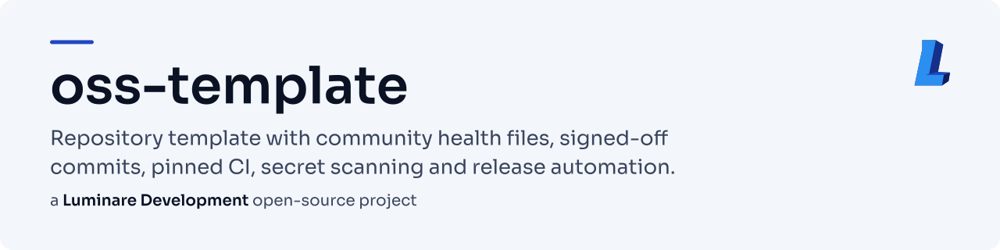
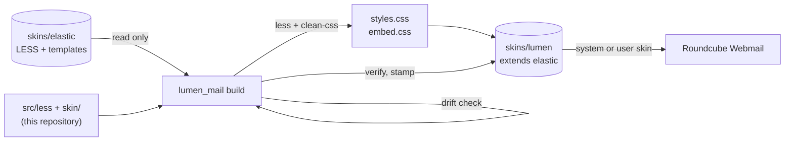

<!-- header:begin: the project page on luminare.tech drops this block, because the page has its own heading -->
<picture>
  <source media="(prefers-color-scheme: dark)" srcset="docs/brand/readme-header-dark.svg">
  <source media="(prefers-color-scheme: light)" srcset="docs/brand/readme-header-light.svg">
  
</picture>

<!-- byline:studio -->
*a [Luminare Development](https://luminare.tech/open-source/lumen-mail/) open-source project*
<!-- /byline:studio -->
<!-- byline:personal
*by Paul Pasaurek · [project page](https://luminare.tech/open-source/lumen-mail/)*
/byline:personal -->
<!-- header:end -->

# lumen-mail

A modern Luminare skin for Roundcube Webmail: a real Roundcube skin called **Lumen** that extends
Elastic, compiled on your server from the Elastic sources installed there.

[](https://github.com/luminare-dev/lumen-mail/actions/workflows/ci.yml)
[](https://github.com/luminare-dev/lumen-mail/releases)
[](LICENSE)
[](https://scorecard.dev/viewer/?uri=github.com/luminare-dev/lumen-mail)

## Why

Elastic is a solid, accessible skin, and every Roundcube installation has it. Restyling it usually
means forking its templates and LESS, which goes stale with the next Roundcube update and turns the
fork into a CC BY-SA adaptation. lumen-mail keeps only its own code: Elastic variable overrides, a
small component layer, one wrapper template and a generator that compiles the skin against
whatever Elastic is installed, checks first that everything it relies on still exists, and stops
with the exact name of what changed if an update moved something.

## Quickstart

```bash
git clone https://github.com/luminare-dev/lumen-mail.git && cd lumen-mail
npm ci --omit=dev --ignore-scripts
PYTHONPATH=generator python3 -m lumen_mail build --roundcube /var/www/roundcube --out /tmp/lumen --no-palette
PYTHONPATH=generator python3 -m lumen_mail verify /tmp/lumen --roundcube /var/www/roundcube
sudo cp -a /tmp/lumen /var/www/roundcube/skins/lumen
```

Then select it: `$config['skin'] = 'lumen';` in `config/config.inc.php` for everybody, or
**Settings → Preferences → User Interface → Interface skin** for one user. On KeyHelp the field is
**Configuration → Webmail → Interface skin**. Details, a dry run and how to remove it:
[docs/install.md](docs/install.md).

## How it works



- **A skin, not a plugin.** `skins/lumen/meta.json` says `"extends": "elastic"`, so Roundcube
  uses Elastic's templates and scripts for everything Lumen does not have.
- **Compiled on the server.** The build points a temporary mirror tree at the installed
  `skins/elastic`, compiles Elastic's `styles.less` with Lumen's tokens, variable overrides and
  component layer after it, resolves every `url()` the way Roundcube looks up skin files (Lumen
  first, then `../../elastic/…`), adds a cache-buster, checks that each target exists and is
  served, and adds the licence banner.
- **One wrapper template.** `templates/includes/footer.html` adds Lumen's scripts and includes
  Elastic's footer with `skinpath="skins/elastic"`; no Elastic template is copied.
- **Safe after updates.** `lumen-build.stamp` records the Roundcube version, a digest of Elastic's
  LESS and templates and the sha256 of every file, so `verify` knows when a rebuild is due.

## Design decisions

The decisions behind this project are recorded as short ADRs in [docs/adr/](docs/adr/):

- [ADR 0001: Record architecture decisions](docs/adr/0001-record-architecture-decisions.md)
- [ADR 0002: Pin every action and downloaded tool](docs/adr/0002-pin-actions-and-downloaded-tools.md)
- [ADR 0003: Secret scanning with the gitleaks binary](docs/adr/0003-secret-scanning-with-the-gitleaks-binary.md)
- [ADR 0004: Draft releases with checksums and provenance](docs/adr/0004-draft-releases-with-checksums-and-provenance.md)
- [ADR 0005: A skin that extends Elastic, compiled on the server](docs/adr/0005-a-skin-that-extends-elastic-built-on-the-server.md)
- [ADR 0006: Swap Elastic's default logo at run time](docs/adr/0006-swap-the-logo-at-run-time.md)
- [ADR 0007: Sora as WOFF, and a stamp file that is not served](docs/adr/0007-sora-as-woff-and-a-stamp-that-is-not-served.md)

What Lumen changes in Elastic, and why, is listed in
[docs/elastic-inventory.md](docs/elastic-inventory.md); every text and UI colour pair is in
[docs/contrast.md](docs/contrast.md).

**Alternatives.** Elastic itself documents `_variables.less` and `_styles.less` for local colour
changes; that works well for one server but lives inside `skins/elastic`, which an update
replaces. A full fork of a skin gives total control at the cost of following every Roundcube
release by hand. lumen-mail sits in between: Elastic's structure, our look, rebuilt on demand.

## Supported versions

| Component | Tested with | Supported |
|---|---|---|
| Roundcube Webmail (Elastic skin) | 1.7.3 (drift check and stand-in builds against its Elastic) | any Roundcube whose Elastic passes the drift check; only 1.7.3 has been checked |
| Node.js (build only) | 22.23 on this server; the CI skin job uses 22 | 20 or later (`engines` in package.json) |
| Python (generator) | 3.12 | 3.12; the code needs 3.10 or later and only the standard library |
| Browsers | as Elastic | the last two versions of Chrome, Edge, Firefox and Safari |

Fixes go into the latest minor release only. See the
[security policy](https://github.com/luminare-dev/.github/blob/main/SECURITY.md) for reporting.

## Limitations

- Plugins keep their own Elastic styles (for example the managesieve and password forms); they
  pick up Lumen's colours only where they use Elastic's classes.
- In Roundcube's `devel_mode`, Elastic's `layout.html` loads Elastic's LESS in the browser, so the
  page shows plain Elastic.
- The Luminare logo is set by a script before Elastic's UI starts; without JavaScript the logo
  area stays empty (Roundcube itself needs JavaScript).
- Roundcube does not set `dir="rtl"` for Elastic; Lumen's own rules use logical properties, but
  Elastic's layout stays left-to-right.
- Message bodies keep their senders' colours.
- Only Roundcube 1.7.3 has been tested.

## Results

| What | Value | How it was measured |
|---|---|---|
| Generator and contrast tests | 39 tests pass (34 generator, 5 contrast) | `python3 -m unittest discover -s tests` with the stand-in compiler, 2026-10-21 |
| Drift check | passes against Roundcube 1.7.3's Elastic: 161 Elastic variables set, 3 read, every file and marker present | `lumen_mail.elastic.check_drift`, 2026-10-21 |
| Pipeline against the installed Elastic | build and verify pass with the stand-in compiler (url resolution, cache-busters, served types, stamp) | `build --compiler tests/stub_compiler.py` against Roundcube 1.7.3, 2026-10-21 |
| Contrast | 58 pairs pass WCAG 2.2 AA in light and dark mode; lowest 3.43:1 (light) and 3.17:1 (dark), both UI parts with a 3:1 minimum | `python3 scripts/contrast.py`, 2026-10-21 |
| Font | Sora variable font 60,684 bytes as WOFF (TTF 111,400) | `scripts/build_font.py`, 2026-10-21 |

## Documentation and links

- [Installation](docs/install.md) · [Configuration](docs/configuration.md) ·
  [Upgrade](docs/upgrade.md) · [Troubleshooting](docs/troubleshooting.md) ·
  [Runbook](docs/runbook.md) · [Elastic inventory](docs/elastic-inventory.md) ·
  [Contrast](docs/contrast.md) · [ADRs](docs/adr/)
- [Changelog](CHANGELOG.md) and [releases](https://github.com/luminare-dev/lumen-mail/releases)
  (each release has `SHA256SUMS` and a build provenance attestation)
- [Contributing](https://github.com/luminare-dev/.github/blob/main/CONTRIBUTING.md) ·
  [Code of conduct](https://github.com/luminare-dev/.github/blob/main/CODE_OF_CONDUCT.md) ·
  [Security](https://github.com/luminare-dev/.github/blob/main/SECURITY.md) ·
  [Support](https://github.com/luminare-dev/.github/blob/main/SUPPORT.md)
- Project page: <https://luminare.tech/open-source/lumen-mail/>

## Not affiliated

Not affiliated with or endorsed by the Roundcube project. Roundcube and Elastic are named only to
describe what this project works with.

Not affiliated with or endorsed by Keyweb AG. KeyHelp is a registered trademark of Keyweb AG; it is
named only because the skin can be selected in KeyHelp's webmail settings.

## Licence

[MIT](LICENSE). The licence covers the code only: the project name, logo, header images,
`docs/brand/`, the logo files in `skin/images/` and `skin/thumbnail.png` are not licensed (see
[NOTICE](NOTICE)). The stylesheets the generator compiles on your server are an adaptation of
Roundcube's Elastic skin and are licensed under
[CC BY-SA 3.0](https://creativecommons.org/licenses/by-sa/3.0/), like Elastic; the installed
skin's `README.md` credits Elastic's authors. Sora is under the SIL Open Font License 1.1.

<!-- byline:studio -->
*a [Luminare Development](https://luminare.tech/open-source/lumen-mail/) open-source project*
<!-- /byline:studio -->
<!-- byline:personal
*by Paul Pasaurek · [project page](https://luminare.tech/open-source/lumen-mail/)*
/byline:personal -->
