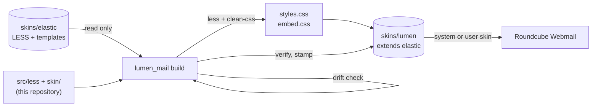

<!-- header:begin: the project page on luminare.tech drops this block, because the page has its own heading -->
<picture>
  <source media="(prefers-color-scheme: dark)" srcset="docs/brand/readme-header-dark.svg">
  <source media="(prefers-color-scheme: light)" srcset="docs/brand/readme-header-light.svg">
  
</picture>

<!-- byline:studio -->
*a [Luminare Development](https://luminare.tech/open-source/lumen-mail/) open-source project*
<!-- /byline:studio -->
<!-- byline:personal
*by Paul Pasaurek · [project page](https://luminare.tech/open-source/lumen-mail/)*
/byline:personal -->
<!-- header:end -->

# lumen-mail

A modern Luminare skin for Roundcube Webmail: a real Roundcube skin called **Lumen** that extends
Elastic, compiled on your server from the Elastic sources installed there, with a Ctrl+K command
palette for folders, settings and actions.

[](https://github.com/luminare-dev/lumen-mail/actions/workflows/ci.yml)
[](https://github.com/luminare-dev/lumen-mail/releases)
[](LICENSE)
[](https://scorecard.dev/viewer/?uri=github.com/luminare-dev/lumen-mail)

## Why

Elastic is a solid, accessible skin, and every Roundcube installation has it. Restyling it usually
means forking its templates and LESS, which goes stale with the next Roundcube update and turns the
fork into a CC BY-SA adaptation. lumen-mail keeps only its own code: Elastic variable overrides, a
small component layer, one wrapper template and a generator that compiles the skin against
whatever Elastic is installed, checks first that everything it relies on still exists, and stops
with the exact name of what changed if an update moved something.

## Screenshots

<!-- Screenshot slots, filled at the first release (docs/screenshots/, example data only):
     login page (light), mail view (dark), the command palette (light), settings at 360 px (dark).
     The gallery's skin previews (docs/development.md) render the same views locally. -->

Screenshots follow with the first release; until then the [gallery](#gallery) renders the skin's
mail, settings and login views locally.

## Features

- **A real Roundcube skin**, `skins/lumen`, that extends Elastic: every layout, touch and phone
  behaviour of Elastic stays, with Luminare's colours, the Sora typeface, an 8 px grid, rounded
  surfaces with subtle borders, a Night task rail and clear focus rings.
- **Light and dark mode**, both with Elastic's own switch; every text and UI colour pair passes
  WCAG 2.2 AA ([contrast table](docs/contrast.md)); prefers-reduced-motion is respected.
- **Command palette:** Ctrl+K (Cmd+K on a Mac) or **Jump to** in the menu opens a search over
  folders, settings pages and sections, tasks (plugin tasks included) and actions (compose, check
  mail, search, dark mode, about, logout). Fuzzy search ignores case and accents; it is a modal
  ARIA dialog with a listbox, keyboard-only friendly, in the user's language through Roundcube's
  labels, and right-to-left in right-to-left languages. It reads everything from the page, sends
  nothing anywhere and stores nothing.
- **Luminare branding:** the logo on the login page and in the menu (an admin's `skin_logo`
  still wins), favicon, theme colours and the skin chooser thumbnail.
- **Safe after Roundcube updates:** the build is checked against the installed Elastic first,
  and the optional systemd units restore and rebuild the skin by themselves.
- **No Roundcube file in this repository**: the stylesheets are compiled where the skin is
  installed, from the Elastic that is there ([why](#how-it-works)).

## Quickstart

On the server that runs Roundcube (as root; Node.js 22 or 20.19+, npm and Python 3.10+):

```bash
git clone https://github.com/luminare-dev/lumen-mail.git && cd lumen-mail
npm ci --ignore-scripts --no-audit --no-fund && npm run build:palette
PYTHONPATH=generator python3 -m lumen_mail install-runtime --prefix /opt/lumen-mail
/opt/lumen-mail/bin/lumen-mail install --roundcube /var/www/roundcube
```

Then select it: `$config['skin'] = 'lumen';` in `config/config.inc.php` for everybody, or
**Settings → Preferences → User Interface → Interface skin** for one user. On KeyHelp the field is
**Configuration → Webmail → Interface skin**. The systemd units in `contrib/systemd/` restore and
rebuild the skin after Roundcube updates.

Two ways to install, both described with the KeyHelp commands, verification and rollback in
[docs/install.md](docs/install.md):

- **Build on the server (recommended):** the commands above. The skin is compiled against the
  exact Elastic of your Roundcube and rebuilt after updates.
- **Release package:** each release has `lumen-<version>-roundcube-<version>.tar.gz` (and
  `.zip`), built in CI against that official Roundcube release, to extract into
  `<roundcube>/skins/`. No Node needed; it fits the same Roundcube minor series.

## How it works



- **A skin, not a plugin.** `skins/lumen/meta.json` says `"extends": "elastic"`, so Roundcube
  uses Elastic's templates and scripts for everything Lumen does not have.
- **Compiled on the server.** The build points a temporary mirror tree at the installed
  `skins/elastic`, compiles Elastic's `styles.less` with Lumen's tokens, variable overrides and
  component layer after it, resolves every `url()` the way Roundcube looks up skin files (Lumen
  first, then `../../elastic/…`), adds a cache-buster, checks that each target exists and is
  served, and adds the licence banner.
- **One wrapper template.** `templates/includes/footer.html` adds Lumen's scripts and the labels
  the palette needs, then includes Elastic's footer with `skinpath="skins/elastic"`; no Elastic
  template is copied.
- **The command palette is a skin asset.** Vite builds it once into `lumen-palette.js` (React in
  a shadow root, styled by the skin's tokens); every build copies it into `skins/lumen/` and there
  is no option to leave it out. Its items run through `rcmail.command()` or Elastic's own
  buttons, so Roundcube's checks apply ([ADR 0010](docs/adr/0010-a-command-palette-as-a-skin-asset.md)).
- **Why no Elastic file is in the repository.** Elastic is licensed under CC BY-SA 3.0; a copy
  of its templates or LESS would make this repository an adaptation and go stale with the next
  Roundcube release. Lumen only names Elastic's variables, selectors and templates, and the
  generator compiles against the copy every Roundcube installation already has.
- **Safe after updates.** `lumen-build.stamp` records the Roundcube version, a digest of Elastic's
  LESS and templates and the sha256 of every file, so `verify` knows when a rebuild is due.
- **Restore at once, rebuild later.** KeyHelp deletes the whole Roundcube folder on every
  Roundcube update. A systemd path unit notices the deletion, and `lumen-mail sync` copies the
  last good build back as soon as the new release is extracted (no Node, milliseconds), then
  rebuilds against the new Elastic when the update has finished, with an atomic swap. A failed
  rebuild keeps the working build. Details: [docs/update-safety.md](docs/update-safety.md).

## Design decisions

The decisions behind this project are recorded as short ADRs in [docs/adr/](docs/adr/):

- [ADR 0001: Record architecture decisions](docs/adr/0001-record-architecture-decisions.md)
- [ADR 0002: Pin every action and downloaded tool](docs/adr/0002-pin-actions-and-downloaded-tools.md)
- [ADR 0003: Secret scanning with the gitleaks binary](docs/adr/0003-secret-scanning-with-the-gitleaks-binary.md)
- [ADR 0004: Draft releases with checksums and provenance](docs/adr/0004-draft-releases-with-checksums-and-provenance.md)
- [ADR 0005: A skin that extends Elastic, compiled on the server](docs/adr/0005-a-skin-that-extends-elastic-built-on-the-server.md)
- [ADR 0006: Swap Elastic's default logo at run time](docs/adr/0006-swap-the-logo-at-run-time.md)
- [ADR 0007: Sora as WOFF, and a stamp file that is not served](docs/adr/0007-sora-as-woff-and-a-stamp-that-is-not-served.md)
- [ADR 0008: Restore at once, rebuild later](docs/adr/0008-restore-at-once-rebuild-later.md)
- [ADR 0009: A release package built against a pinned Roundcube](docs/adr/0009-a-release-package-built-against-a-pinned-roundcube.md)
- [ADR 0010: A command palette as a skin asset](docs/adr/0010-a-command-palette-as-a-skin-asset.md)

What Lumen changes in Elastic, and why, is listed in
[docs/elastic-inventory.md](docs/elastic-inventory.md); every text and UI colour pair is in
[docs/contrast.md](docs/contrast.md).

**Alternatives.** Elastic itself documents `_variables.less` and `_styles.less` for local colour
changes; that works well for one server but lives inside `skins/elastic`, which an update
replaces. A full fork of a skin gives total control at the cost of following every Roundcube
release by hand. lumen-mail sits in between: Elastic's structure, our look, rebuilt on demand.

## Supported versions

| Component | Tested with | Supported |
|---|---|---|
| Roundcube Webmail (Elastic skin) | 1.7.3, as shipped by KeyHelp 26.1.1 (drift check, builds, a scratch copy served with `php -S`, pages rendered by Roundcube's template engine) | the 1.7 series; the features Lumen uses exist since 1.5, the oldest release they allow (see [install](docs/install.md)); older releases are untested |
| systemd (sync units, optional) | 255 (`systemd-analyze verify` and `security`; not yet started on a server) | path units with `PathChanged=` and `StateDirectory=` |
| Node.js (build only) | 22.23 on this server; CI uses 22 | 22.12 or later, or 20.19 or later (Vite 8; the LESS compile alone runs on any Node 20) |
| Python (generator) | 3.12 | 3.12; the code needs 3.10 or later and only the standard library |
| Browsers | as Elastic | the last two versions of Chrome, Edge, Firefox and Safari |

Fixes go into the latest minor release only. See the [security policy](SECURITY.md) for
reporting.

## Limitations

- Plugins keep their own Elastic styles (for example the managesieve and password forms); they
  pick up Lumen's colours only where they use Elastic's classes.
- In Roundcube's `devel_mode`, Elastic's `layout.html` loads Elastic's LESS in the browser, so the
  page shows plain Elastic.
- The Luminare logo is set by a script before Elastic's UI starts; without JavaScript the logo
  area stays empty (Roundcube itself needs JavaScript).
- Roundcube does not set `dir="rtl"` for Elastic; Lumen's own rules use logical properties, but
  Elastic's layout stays left-to-right.
- Message bodies keep their senders' colours.
- The command palette appears on pages after login only, not on the login, print and error pages,
  in frames or in the external compose window. Its folder list covers the folders Roundcube
  lists in the mail task; elsewhere it offers Inbox.
- The palette bundles React: 72.1 KB gzip, of which React and React DOM are 65.9 KB.
- Only Roundcube 1.7.3 has been tested.
- As the system skin, Lumen depends on `skins/lumen` being present. An update that removes the
  Roundcube folder (KeyHelp does) shows error pages until the sync unit has restored it; without
  the units, until someone does.
- The release package matches the Elastic of one Roundcube release exactly; for other releases of
  the series, building on the server gives the exact match.

## Results

| What | Value | How it was measured |
|---|---|---|
| Tests | 213 Python tests pass, 1 skipped (a check for the template repository only), including 6 that compile against the installed Elastic; 5 `node --test` tests for the logo script | `python3 -m unittest discover -s tests` with Node, gitleaks and markdownlint-cli2 on the PATH; `node --test "tests/js/*.test.mjs"`, 2026-10-21 |
| Real compile | against the installed Elastic of Roundcube 1.7.3: 1.6 s, peak 114 MB RSS; `styles.min.css` 134,735 bytes, `embed.min.css` 4,509 bytes; every `url()` answers 200 through `static.php` | `lumen-mail build` and `verify` with less 4.9.1 and clean-css 5.3.3, Node 22; scratch copy served by `php -S`, 2026-10-21 |
| Simulated KeyHelp update | path unit fired 14 ms after `rm` began; `skins/lumen` restored from the last good build in 0.003 to 0.009 s, always before the page was served with the new `config.inc.php`; login page with Lumen 10 to 22 ms after KeyHelp wrote it; no "Error loading template" in Roundcube's log | scratch copy of Roundcube 1.7.3, KeyHelp's steps, a port of systemd 255's `PathChanged=` logic starting `sync`, login page polled every 50 ms ([update safety](docs/update-safety.md)), 2026-10-21 |
| Rebuild for a new release | 1.4 to 1.7 s build, 6.6 to 7.3 s with the 5 s settle; swapped in atomically, the poller saw no interruption; deferred with exit 75 when `MemAvailable` was below 400 MB, the restored build kept serving | same setup, with `RCMAIL_VERSION` 1.7.4, also run as `keyhelp` (the unit's user), 2026-10-21 |
| Sync with nothing to do | 0.10 to 0.16 s (mean 0.12 s over 10 runs), 21 MB RSS, nothing written, no compiler started | `/usr/bin/time lumen-mail sync` from an `install-runtime` copy, 2026-10-21 |
| Wrapper template | `lumen.js` before Elastic's `ui.min.js`; palette script and its labels only on top-level, non-print, non-error, non-login pages; skin labels reach `rcmail.add_label` in English and German | Roundcube's own template engine on the scratch copy (`about`, `login`, `error`, framed, print, `de_DE`), 2026-10-21 |
| Logo | the Luminare lockup on the login page, the mark in the menu; a `skin_logo` set by the admin wins | `node --test "tests/js/*.test.mjs"` (5 tests), 2026-10-21 |
| Sync unit | `systemd-analyze verify` passes; exposure 0.6 ("SAFE") | `systemd-analyze security --offline=true`, systemd 255, 2026-10-21 |
| Release package | the official 1.7.3 archive's sha256 matches the pin; the archives built from it and from this server's Roundcube are byte-identical; extracted into a second scratch copy, the login page and every asset answer 200 | `scripts/package.py fetch` and `build`, 2026-10-21 |
| Drift check | passes against Roundcube 1.7.3's Elastic: 161 Elastic variables set, 3 read, every file and marker present | `lumen_mail.elastic.check_drift`, 2026-10-21 |
| Contrast | 58 pairs pass WCAG 2.2 AA in light and dark mode; lowest 3.43:1 (light) and 3.17:1 (dark), both UI parts with a 3:1 minimum | `python3 scripts/contrast.py`, 2026-10-21 |
| Font | Sora variable font 60,684 bytes as WOFF (TTF 111,400) | `scripts/build_font.py`, 2026-10-21 |

## Gallery

The gallery is a static React app that shows the design system: every colour role in both
modes, the contrast of every pair (computed in the browser), the Sora type scale, shape and
motion, and the real command palette on a mocked Roundcube, with light/dark, LTR/RTL and
English/German switches.

```bash
npm ci --ignore-scripts --no-audit --no-fund
npm run gallery                                   # dev server
npm run build:gallery                             # gallery/dist, served from any folder
LUMEN_GALLERY_SKINS=/path/to/roundcube/skins npm run gallery
```

With `LUMEN_GALLERY_SKINS` pointing at a folder that holds a built `lumen/` next to its
`elastic/` (for example a test copy of Roundcube after `lumen-mail install`), it adds preview
pages (mail, settings, login) styled by the built skin, at 1280 or 360 pixels. CI keeps the
gallery without a skin as the `gallery` artifact. Details: [docs/development.md](docs/development.md#the-gallery).

## Documentation and links

- [Installation](docs/install.md) · [Update safety](docs/update-safety.md) ·
  [Command reference](docs/cli.md) · [Configuration](docs/configuration.md) ·
  [Upgrade](docs/upgrade.md) · [Troubleshooting](docs/troubleshooting.md) ·
  [Runbook](docs/runbook.md) · [Elastic inventory](docs/elastic-inventory.md) ·
  [Contrast](docs/contrast.md) · [Development](docs/development.md) · [ADRs](docs/adr/)
- [Changelog](CHANGELOG.md) and [releases](https://github.com/luminare-dev/lumen-mail/releases)
  (each release has `SHA256SUMS` and a build provenance attestation)
- [Contributing](CONTRIBUTING.md) ·
  [Code of conduct](https://github.com/luminare-dev/.github/blob/main/CODE_OF_CONDUCT.md) ·
  [Security](SECURITY.md) ·
  [Support](https://github.com/luminare-dev/.github/blob/main/SUPPORT.md)
- Project page: <https://luminare.tech/open-source/lumen-mail/>

## Not affiliated

Not affiliated with or endorsed by the Roundcube project. Roundcube and Elastic are named only to
describe what this project works with.

Not affiliated with or endorsed by Keyweb AG. KeyHelp is a registered trademark of Keyweb AG; it is
named only because the skin can be selected in KeyHelp's webmail settings.

## Licence

[MIT](LICENSE). The licence covers the code only: the project name, logo, header images,
`docs/brand/`, the logo files in `skin/images/` and `skin/thumbnail.png` are not licensed (see
[NOTICE](NOTICE)). The stylesheets the generator compiles on your server, and those in the
release packages, are an adaptation of Roundcube's Elastic skin and are licensed under
[CC BY-SA 3.0](https://creativecommons.org/licenses/by-sa/3.0/), like Elastic; the installed
skin's `README.md` credits Elastic's authors. Sora is under the SIL Open Font License 1.1. The
command palette and the gallery bundle React, React DOM and scheduler (MIT, Copyright (c) Meta
Platforms, Inc. and affiliates; [third-party notices](THIRD_PARTY_NOTICES.md)).

<!-- byline:studio -->
*a [Luminare Development](https://luminare.tech/open-source/lumen-mail/) open-source project*
<!-- /byline:studio -->
<!-- byline:personal
*by Paul Pasaurek · [project page](https://luminare.tech/open-source/lumen-mail/)*
/byline:personal -->
