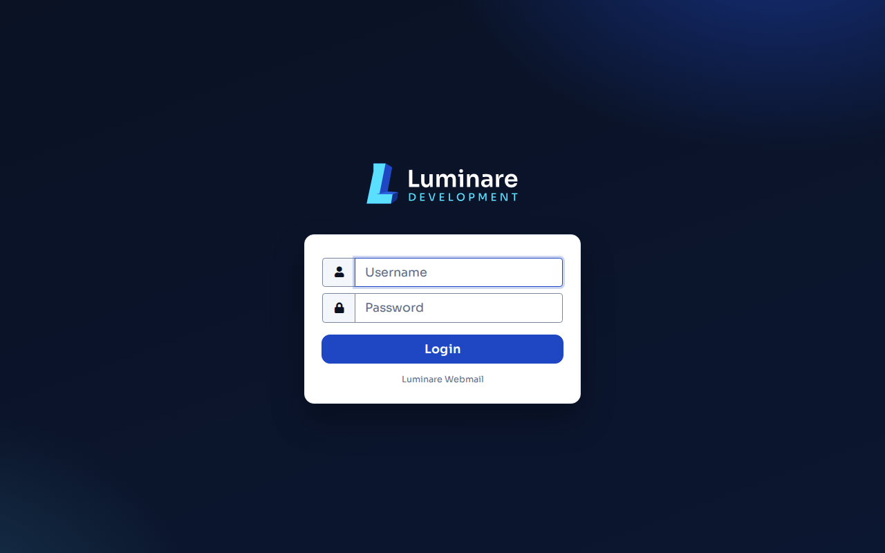
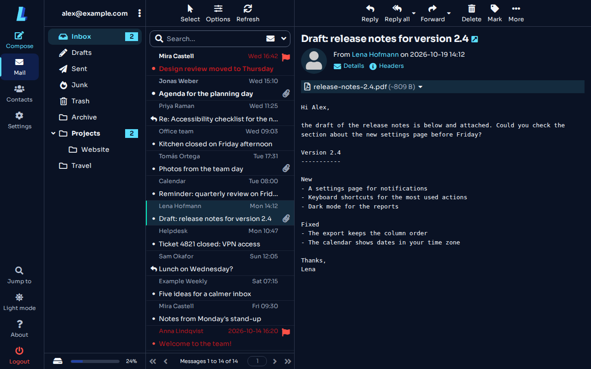
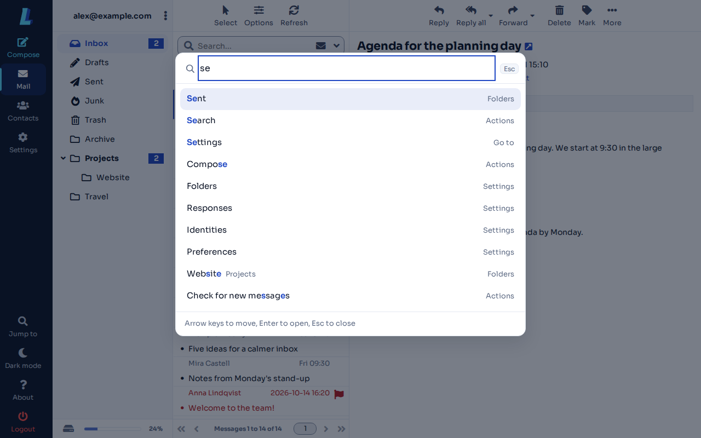
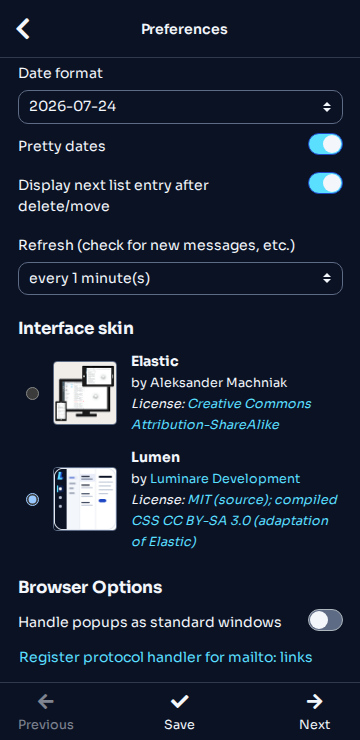

<!-- header:begin: the project page on luminare.tech drops this block, because the page has its own heading -->
<picture>
  <source media="(prefers-color-scheme: dark)" srcset="docs/brand/readme-header-dark.svg">
  <source media="(prefers-color-scheme: light)" srcset="docs/brand/readme-header-light.svg">
  
</picture>

<!-- byline:studio -->
*a [Luminare Development](https://luminare.tech/open-source/lumen-mail/) open-source project*
<!-- /byline:studio -->
<!-- byline:personal
*by Paul Pasaurek · [project page](https://luminare.tech/open-source/lumen-mail/)*
/byline:personal -->
<!-- header:end -->

# lumen-mail

A modern Luminare skin for Roundcube Webmail: **Lumen** extends Elastic, is compiled on your
server from the installed Elastic, and adds a Ctrl+K command palette.

[](https://github.com/luminare-dev/lumen-mail/actions/workflows/ci.yml)
[](https://github.com/luminare-dev/lumen-mail/releases)
[](LICENSE)
[](https://scorecard.dev/viewer/?uri=github.com/luminare-dev/lumen-mail)

## Screenshots

Roundcube 1.7.3 with Lumen, example data only.

| Login page (light) | Mail view (dark) |
|---|---|
|  |  |

| Command palette (light) | Settings at 360 px (dark) |
|---|---|
|  |  |

## Features

- A real Roundcube skin, `skins/lumen`, that extends Elastic: Luminare colours, the Sora
  typeface, a Night task rail and clear focus rings, with all of Elastic's layouts kept.
- Light and dark mode; every colour pair passes WCAG 2.2 AA ([contrast table](docs/contrast.md)).
- Command palette: Ctrl+K (Cmd+K on a Mac) or **Jump to** in the menu searches folders,
  settings, tasks and actions. It reads everything from the page and sends or stores nothing.
- No Roundcube or Elastic file in this repository: the stylesheets are compiled on your server
  from the Elastic that is installed there, after a check that everything Lumen uses still exists.
- Optional systemd units that restore and rebuild the skin after Roundcube updates.

## Quickstart

On the server that runs Roundcube (as root; Node.js 22 or 20.19+, npm and Python 3.10+):

```bash
git clone https://github.com/luminare-dev/lumen-mail.git && cd lumen-mail
npm ci --ignore-scripts --no-audit --no-fund && npm run build:palette
PYTHONPATH=generator python3 -m lumen_mail install-runtime --prefix /opt/lumen-mail
/opt/lumen-mail/bin/lumen-mail install --roundcube /var/www/roundcube
```

Then select it: `$config['skin'] = 'lumen';` in `config/config.inc.php`, or **Settings →
Preferences → User Interface → Interface skin** for one user (on KeyHelp: **Configuration →
Webmail → Interface skin**).

Each release also has a prebuilt package (`lumen-<version>-roundcube-<version>.tar.gz`) to
extract into `<roundcube>/skins/`, no Node needed. Both ways, the KeyHelp steps, the systemd
units and rollback are in [docs/install.md](docs/install.md).

## Supported versions

Tested with Roundcube 1.7.3 (as shipped by KeyHelp 26.1.1); supported on the 1.7 series. Build
needs Node.js 22.12+ or 20.19+ and Python 3.10+ (standard library only). Browsers as Elastic.
Fixes go into the latest minor release only.

## Limitations

- Plugins keep their own Elastic styles where they don't use Elastic's classes.
- In `devel_mode` the page shows plain Elastic.
- The logo is set by a script; without JavaScript the logo area stays empty.
- The palette is not on the login, print and error pages, in frames or in the external compose
  window. It bundles React (about 72 KB gzip).
- As the system skin, Lumen needs `skins/lumen` to exist. KeyHelp removes the whole Roundcube
  folder on updates, so use the sync units there.

## Documentation

[Installation](docs/install.md) · [Upgrade](docs/upgrade.md) ·
[Configuration](docs/configuration.md) · [Command reference](docs/cli.md) ·
[Update safety](docs/update-safety.md) · [Troubleshooting](docs/troubleshooting.md) ·
[Runbook](docs/runbook.md) · [Development](docs/development.md) ·
[Changelog](CHANGELOG.md)

[Contributing](CONTRIBUTING.md) ·
[Code of conduct](https://github.com/luminare-dev/.github/blob/main/CODE_OF_CONDUCT.md) ·
[Security](SECURITY.md) ·
[Support](https://github.com/luminare-dev/.github/blob/main/SUPPORT.md) ·
Project page: <https://luminare.tech/open-source/lumen-mail/>

## Not affiliated

Not affiliated with or endorsed by the Roundcube project. Roundcube and Elastic are named only to
describe what this project works with.

Not affiliated with or endorsed by Keyweb AG. KeyHelp is a registered trademark of Keyweb AG; it is
named only because the skin can be selected in KeyHelp's webmail settings.

## Licence

[MIT](LICENSE). The licence covers the code only: the project name, logo, header images,
`docs/brand/`, the logo files in `skin/images/` and `skin/thumbnail.png` are not licensed (see
[NOTICE](NOTICE)). The stylesheets the generator compiles on your server, and those in the
release packages, are an adaptation of Roundcube's Elastic skin and are licensed under
[CC BY-SA 3.0](https://creativecommons.org/licenses/by-sa/3.0/), like Elastic; the installed
skin's `README.md` credits Elastic's authors. Sora is under the SIL Open Font License 1.1. The
command palette and the gallery bundle React, React DOM and scheduler (MIT, Copyright (c) Meta
Platforms, Inc. and affiliates; [third-party notices](THIRD_PARTY_NOTICES.md)).

<!-- byline:studio -->
*a [Luminare Development](https://luminare.tech/open-source/lumen-mail/) open-source project*
<!-- /byline:studio -->
<!-- byline:personal
*by Paul Pasaurek · [project page](https://luminare.tech/open-source/lumen-mail/)*
/byline:personal -->
